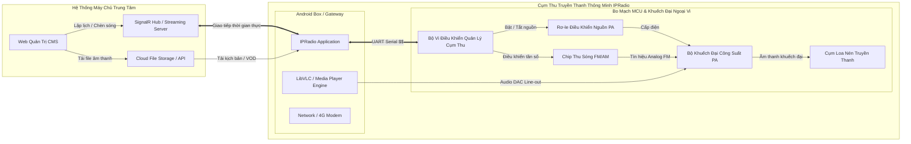

# Tài Liệu Đặc Tả Yêu Cầu Chức Năng Hệ Thống (Functional Specification Document - FSD)

> **Dự án**: IPRadio (Hệ thống thiết bị đầu cuối truyền thanh thông minh ứng dụng CNTT - Viễn thông)  
> **Phiên bản tài liệu**: 1.0  
> **Ngày ban hành**: 12/11/2026  
> **Đối tượng áp dụng**: Đội ngũ phát triển (Developers), Quản lý dự án (PM), Đảm bảo chất lượng (QA/QC), Đội ngũ triển khai & Kỹ thuật hiện trường.  
> **Mã nguồn liên kết chính**:  
> - Quản lý phát: [`PlayersManager.kt`](file:///d:/Git/IPRadio/app/src/main/java/app/tek4tv/ipradio/core/players_helper/PlayersManager.kt), [`VlcMediaPlayer.kt`](file:///d:/Git/IPRadio/app/src/main/java/app/tek4tv/ipradio/core/players_helper/VlcMediaPlayer.kt)  
> - Lập lịch & Vòng đời: [`MediaScheduler.kt`](file:///d:/Git/IPRadio/app/src/main/java/app/tek4tv/ipradio/core/MediaScheduler.kt), [`MainActivity.kt`](file:///d:/Git/IPRadio/app/src/main/java/app/tek4tv/ipradio/ui/MainActivity.kt), [`BootUpReceiver.kt`](file:///d:/Git/IPRadio/app/src/main/java/app/tek4tv/ipradio/ui/BootUpReceiver.kt)  
> - Điều khiển phần cứng UART: [`SerialPortController.kt`](file:///d:/Git/IPRadio/app/src/main/java/app/tek4tv/ipradio/core/SerialPortController.kt), [`Define.java`](file:///d:/Git/IPRadio/app/src/main/java/app/tek4tv/ipradio/utils/Define.java)  
> - Kết nối máy chủ Cloud: [`HubManager.kt`](file:///d:/Git/IPRadio/app/src/main/java/app/tek4tv/ipradio/core/HubManager.kt), [`MediaRepo.kt`](file:///d:/Git/IPRadio/app/src/main/java/app/tek4tv/ipradio/repo/MediaRepo.kt)

---

## 1. TỔNG QUAN HỆ THỐNG

### 1.1. Mục Tiêu Dự Án
Ứng dụng **IPRadio** là phần mềm nhúng cốt lõi chạy trên các thiết bị Android Gateway/Box chuyên dụng được lắp đặt tại các cụm loa truyền thanh thông minh cấp xã, phường, thị trấn, thôn, bản. Thiết bị hoạt động tự động 24/7, không cần người vận hành trực tiếp tại chỗ, thay thế toàn bộ hệ thống truyền thanh có dây hoặc FM analog cũ.

### 1.2. Mô Hình Phối Hợp Tổng Thể

---

## 2. MA TRẬN ĐỘ ƯU TIÊN NGUỒN PHÁT (PRIORITY MATRIX)

Hệ thống IPRadio quản lý quyền chiếm dụng kênh âm thanh và công suất loa theo mức độ ưu tiên từ cao xuống thấp:

| Mức ưu tiên | Chế độ phát (`playMode`) | Nguồn âm thanh | Kích hoạt bởi | Hành vi chiếm quyền |
| :---: | :--- | :--- | :--- | :--- |
| **P1 (Cao nhất)** | `PLAY_MODE_FORCE` (Live khẩn cấp) | Luồng HLS/RTSP từ Hub hoặc File khẩn cấp | Lệnh CMS qua SignalR Hub (`LIVE`, `PLAY_VOD_LIVE_FORCE`) | **Cắt ngang tức thì** bất kỳ kịch bản nào đang phát. Bật PA mức âm lượng ưu tiên. |
| **P2** | `PLAY_MODE_FORCE` (Tuner khẩn cấp) | Tiếp sóng FM/AM khẩn cấp từ chip Tuner ngoại vi | Lệnh CMS qua SignalR Hub (`PLAY_TUNER_LIVE_FORCE`) | **Cắt ngang kịch bản thường**, chuyển mạch Audio sang Tuner, bật PA chế độ khẩn cấp. |
| **P3** | `PLAY_MODE_SCHEDULE` (Lịch phát thanh) | Tệp VOD tải trước (MP3/AAC), Luồng trực tiếp (Live HLS/RTSP), hoặc Tiếp sóng FM/AM | AlarmManager tự động kích hoạt theo khung giờ lập sẵn | Chỉ phát khi không có lệnh khẩn cấp P1, P2. Chuyển tiếp giữa các bài mượt mà. |
| **P4 (Thấp nhất)** | `PLAY_MODE_IDLE` (Nghỉ / Chờ) | Không có nguồn âm thanh | Hết ca phát, hoặc nhận lệnh `STOP`, `PAUSE` | **Dập tắt hoàn toàn công suất PA** (`turnOffPA`), đưa amply về Mute, ngắt rơ-le chống sôi loa. |

---

## 3. CHI TIẾT CÁC MODULE CHỨC NĂNG

### Module 1: Quản Lý & Lập Lịch Phát Thanh Tự Động (Scheduled Playback)

#### 1.1. Cơ chế đồng bộ lịch phát (Online First & Offline Fallback)
* **Online First**: Khi có kết nối mạng, ứng dụng luôn truy vấn kịch bản phát hôm nay từ `todayScenario.sourceUrl` qua [`MediaRepo.kt`](file:///d:/Git/IPRadio/app/src/main/java/app/tek4tv/ipradio/repo/MediaRepo.kt) để đảm bảo cập nhật ngay khi cán bộ quản trị sửa lịch trên CMS.
* **Offline Fallback**: Khi mất mạng 4G/Internet, thiết bị tự động nạp lịch từ file cache cục bộ đã lưu trên bộ nhớ trong (`readItemsFromFile()`), đảm bảo các khung giờ đã định vẫn phát đúng giờ.

#### 1.2. Định thời chính xác bằng Android `AlarmManager`
* Ứng dụng sử dụng [`MediaScheduler.kt`](file:///d:/Git/IPRadio/app/src/main/java/app/tek4tv/ipradio/core/MediaScheduler.kt) để đặt các mốc báo thức chính xác đến từng giây thông qua `AlarmClockInfo`.
* Đảm bảo hệ điều hành Android đánh thức thiết bị ngay cả khi đang trong chế độ tiết kiệm pin (Doze Mode).

#### 1.3. Hỗ trợ ca phát vắt qua nửa đêm (Cross-Midnight Scheduling)
* Hệ thống xử lý khung giờ bắt đầu từ đêm hôm trước và kết thúc vào sáng hôm sau (Ví dụ: `23:30:00 - 00:30:00`).
* Logic trong [`PlayersManager.kt`](file:///d:/Git/IPRadio/app/src/main/java/app/tek4tv/ipradio/core/players_helper/PlayersManager.kt) tự động nhận diện nếu `startTime.after(endTime)` để bù trừ ngày chính xác, không làm lỡ lịch hoặc đứt ca phát.

#### 1.4. Tự động tải trước dữ liệu âm thanh (Pre-downloading)
* Toàn bộ các tệp VOD (MP3, WAV, AAC...) trong lịch hôm nay được tải trước về thư mục cục bộ (`AppStorageManager`).
* Khi đến giờ phát, player đọc thẳng tệp từ bộ nhớ trong để hạn chế giật lag do mạng và tiết kiệm băng thông gói cước 4G.

#### 1.5. Chuyển bài liền mạch không ngắt rơ-le công suất
* Trong một khung giờ gồm nhiều bài (Ví dụ: MP3 $\rightarrow$ Live $\rightarrow$ MP3):
* Khi kết thúc bài trước, hàm `playNextMedia()` tự động nạp bài tiếp theo.
* **Quy tắc bảo vệ**: Giữ rơ-le PA **bật liên tục** trong suốt ca phát, tuyệt đối không gửi lệnh tắt rơ-le giữa các bài để tránh gây ra tiếng "bụp" hoặc nổ màng loa nén.

---

### Module 2: Phát Thanh Khẩn Cấp & Ưu Tiên Đè Sóng (Emergency Broadcast)

#### 2.1. Tiếp nhận và xử lý lệnh khẩn cấp tức thời
* Tiếp nhận qua kết nối WebSocket/SignalR thời gian thực: `LIVE`, `PLAY_VOD_LIVE_FORCE`, `PLAY_TUNER_LIVE_FORCE`.
* Ngắt lập tức nội dung thường đang phát, chuyển cờ hệ thống sang `playMode = PLAY_MODE_FORCE`.

#### 2.2. Cơ chế Resume Point cho bản tin khẩn cấp dạng File
* Nếu bản tin khẩn cấp là tệp ghi âm (thông báo bão, hỏa hoạn) và trong lúc phát thiết bị bị mất điện hoặc khởi động lại:
* Hàm `calculateResumeLivePoint()` trong [`PlayersManager.kt`](file:///d:/Git/IPRadio/app/src/main/java/app/tek4tv/ipradio/core/players_helper/PlayersManager.kt) tính toán số giây đã trôi qua kể từ khi lệnh bắt đầu:
  $$\text{Resume Time} = \text{Current Time} - \text{Start Force Time}$$
* Nạp tham số `:start-time` vào LibVLC trong [`VlcMediaPlayer.kt`](file:///d:/Git/IPRadio/app/src/main/java/app/tek4tv/ipradio/core/players_helper/VlcMediaPlayer.kt) để tua phát tiếp đúng đoạn dở dang, **không phát lại từ đầu**.
* Đối với các luồng Live trực tiếp (RTSP/HLS/Icecast): Không nạp `:start-time` để đảm bảo bắt đúng cạnh phát trực tiếp mới nhất.

#### 2.3. Hoàn trả trạng thái sau khi hết khẩn cấp
* Khi nhận lệnh `STOP_FORCE` hoặc luồng khẩn cấp kết thúc (`onEndForceMedia()`):
  1. Gửi lệnh dập PA tạm thời (`turnOffPA`).
  2. Xóa dữ liệu khẩn cấp và gọi `startPlayingMedia()`.
  3. Kiểm tra đồng hồ hệ thống: Nếu thời điểm hiện tại vẫn nằm trong khung giờ của lịch phát ngày thường $\rightarrow$ Tự động bật lại bài theo lịch; nếu ngoài giờ $\rightarrow$ Giữ PA tắt hoàn toàn.

---

### Module 3: Quản Lý Phần Cứng & Khuếch Đại Công Suất PA (Hardware & PA Controller)

#### 3.1. Quy trình bật / tắt công suất PA an toàn
* Chi tiết tuân thủ quy chuẩn theo ma trận tại [`docs/playback_and_pa_matrix.md`](file:///d:/Git/IPRadio/docs/playback_and_pa_matrix.md):
  * **Bật PA**: Chỉ bật khi Player đã giải mã thành công và bắt đầu có tín hiệu âm thanh thực tế (`onPlayMediaSuccess` $\rightarrow$ gửi `Function 0` hoặc `Function 1`).
  * **Tắt PA**: Tắt ngay lập tức khi hết ca phát hoặc khi luồng Live bị mất kết nối quá số lần retry cho phép (`onTimeOver` / `onLiveError` $\rightarrow$ gửi `Function 10`).

#### 3.2. Điều khiển chip Tuner FM/AM ngoại vi
* Khi lịch phát yêu cầu tiếp sóng đài phát thanh quốc gia/tỉnh:
  * Android gửi gói tin `Function 13` nạp mã cụm thu (PI) và tên đài (PS).
  * Android gửi gói tin `Function 1` (hoặc `Function 7` nếu khẩn cấp) cấu hình tần số (bước $0.1\text{ MHz}$ đối với FM, $1\text{ KHz}$ đối với AM).
  * Bo điều khiển MCU tự động kích hoạt rơ-le chuyển mạch Audio từ cổng Android DAC sang ngõ ra của chip Tuner.

#### 3.3. Cơ chế Safety Watchdog 2 chiều (Chống rò rỉ PA & Chống sập nguồn)
* **Chiều Android $\rightarrow$ MCU (Chu kỳ 3 giây)**:
  * Gửi `Function 2`: Reset bộ đếm treo của vi điều khiển, đồng thời báo tình trạng mạng (`0`: mất mạng, `1`: kết nối Hub tốt, `2`: mất kết nối Hub), địa chỉ MAC và độ nhạy sóng dBm.
* **Chiều MCU $\rightarrow$ Android (Chu kỳ ~5 giây qua gói `$$ , 1, 8`)**:
  * **Chống rò rỉ điện PA**: Nếu Player phía Android đang ở trạng thái dừng (`isPlaying == false`), nhưng MCU báo `paState == "1"` $\rightarrow$ Android lập tức gửi `Function 10` để cưỡng bức tắt PA, triệt tiêu tiếng hú xì và chống nóng chập loa.
  * **Tự khôi phục âm thanh**: Nếu Player phía Android đang phát (`isPlaying == true`), nhưng MCU báo `paState == "0"` hoặc `Volume == "0"` (do sụt áp hoặc MCU vừa reset) $\rightarrow$ Android tự động gọi `syncPAState()` để kích hoạt lại PA và khôi phục âm lượng.
  * **Bảo vệ quá nhiệt**: Theo dõi trường `Temperature` từ MCU; nếu nhiệt độ vượt ngưỡng cho phép ($> 85^\circ\text{C}$), hệ thống có căn cứ cảnh báo về trung tâm.

---

### Module 4: Điều Khiển & Giám Sát Từ Xa Qua Cloud (Cloud Management & Telemetry)

#### 4.1. Kênh liên lạc SignalR Hub 2 chiều
* Duy trì kết nối liên tục, tự động đăng nhập xác thực lại bằng Token khi bị rớt kết nối.
* Heartbeat định kỳ 30 giây: Client gửi Ping $\rightarrow$ Server gửi Pong để đảm bảo đường truyền thông suốt.

#### 4.2. Bộ tập lệnh điều khiển từ xa ([`HubCommand.kt`](file:///d:/Git/IPRadio/app/src/main/java/app/tek4tv/ipradio/utils/HubCommand.kt))
* **Nhóm lệnh điều khiển phát**:
  * `START`, `STOP`, `PAUSE`, `NEXT`, `PREVIEW`, `JUMP`.
* **Nhóm lệnh điều khiển phần cứng**:
  * `TURN_ON_PA`, `TURN_OFF_PA`: Bật/tắt cưỡng bức rơ-le công suất.
  * `SET_VOLUME_DEVICE`: Thay đổi âm lượng loa từ xa (dải 0 - 80).
  * `SET_MUTE_DEVICE`: Cắt tiếng tạm thời toàn cụm loa.
  * `SWITCH_MODE_FM`: Chuyển mạch nguồn nghe đài FM.
* **Nhóm lệnh cập nhật kịch bản**:
  * `UPDATE_LIST`, `UPDATE_MONTHLY_LIST`: Cập nhật và nạp lại lịch phát mới từ CMS.
* **Nhóm lệnh chẩn đoán & Hỗ trợ kỹ thuật**:
  * `CAPTURE_SCREEN`: Chụp ảnh màn hình hiển thị của app và gửi về CMS để kỹ thuật viên kiểm tra trực quan.
  * `GET_LOCATION`: Đọc tọa độ GPS và thông tin trạm BTS/Cell Tower phục vụ định vị cụm loa trên bản đồ số GIS.
  * `NETWORK_INFO`, `STORAGE_INFO`: Kiểm tra tình trạng dung lượng bộ nhớ và tốc độ mạng.
  * `RESTART`: Khởi động lại ứng dụng.

#### 4.3. Báo cáo dữ liệu đo lường định kỳ (Telemetry)
* Định kỳ đóng gói dữ liệu qua [`DataLogModel.kt`](file:///d:/Git/IPRadio/app/src/main/java/app/tek4tv/ipradio/model/DataLogModel.kt) gửi lên [`LogService.kt`](file:///d:/Git/IPRadio/app/src/main/java/app/tek4tv/ipradio/network/LogService.kt):
  * Trạng thái bài đang phát, ID ca phát, thời gian phát thực tế.
  * Trạng thái PA, mức âm lượng hiện thời.
  * Loại mạng kết nối (`4G`, `WIFI`), cường độ tín hiệu sóng di động (`-xx dBm`).

---

### Module 5: Tự Hành 24/7 & Tự Phục Hồi Sự Cố (Self-Healing & Maintenance)

#### 5.1. Khởi động tự động cùng nguồn điện
* Đăng ký [`BootUpReceiver.kt`](file:///d:/Git/IPRadio/app/src/main/java/app/tek4tv/ipradio/ui/BootUpReceiver.kt) bắt các broadcast:
  * `Intent.ACTION_BOOT_COMPLETED`
  * `Intent.ACTION_LOCKED_BOOT_COMPLETED`
  * `android.intent.action.QUICKBOOT_POWERON`
* Đảm bảo khi trạm điện có điện trở lại sau khi mất điện lưới, Android Box khởi động lên là ứng dụng tự động chạy ngay lập tức mà không cần màn hình hay bàn phím.

#### 5.2. Tự động bảo trì chuyển ngày lúc 00:15 hàng đêm
* [`MediaScheduler.kt`](file:///d:/Git/IPRadio/app/src/main/java/app/tek4tv/ipradio/core/MediaScheduler.kt) cài đặt Alarm cố định lúc **00:15:00** (`ACTION_CHECKHUB_RESET`):
  1. Đảm bảo PA ở trạng thái tắt an toàn.
  2. Làm mới Token xác thực, kết nối lại SignalR Hub.
  3. Tải danh sách lịch phát cho ngày mới.
  4. Lập lịch Alarm cho các khung giờ phát trong ngày hôm đó.

#### 5.3. Dọn dẹp bộ nhớ đệm an toàn (Smart Disk Cleanup)
* Khi dung lượng bộ nhớ trong của Android Box còn trống **dưới 1 GB**:
* Hàm `clearDatastore()` trong [`MainViewModel.kt`](file:///d:/Git/IPRadio/app/src/main/java/app/tek4tv/ipradio/viewmodels/MainViewModel.kt) kích hoạt:
  * Xóa toàn bộ file ghi âm cũ và file log đã đồng bộ lên server.
  * **Bảo vệ dữ liệu hôm nay**: Đối chiếu danh sách tệp thuộc lịch phát ngày hôm nay (`broadcastList`), **chỉ xóa các file âm thanh cũ của những ngày trước**, tuyệt đối không xóa nhầm file sắp phát hôm nay để tránh việc phải tải lại bằng 4G.

#### 5.4. Cập nhật phần mềm từ xa (OTA Silent Update)
* Nhận lệnh cập nhật phiên bản từ Hub (`UPDATE_VERSION`).
* Tải file APK mới về thư mục tạm.
* Sử dụng quyền Root thông qua [`SuUtils.kt`](file:///d:/Git/IPRadio/app/src/main/java/app/tek4tv/ipradio/utils/SuUtils.kt) để cài đặt ngầm trong nền (`pm install -r`) và tự động khởi động lại ứng dụng mới mà không cần thao tác bấm chạm trên màn hình.

#### 5.5. Cơ chế bẫy lỗi toàn cục (Global Crash Handling)
* Sử dụng [`CrashHandler.kt`](file:///d:/Git/IPRadio/app/src/main/java/app/tek4tv/ipradio/utils/CrashHandler.kt) bắt toàn bộ các ngoại lệ `UncaughtException`:
* Tự động ghi stack trace chi tiết vào file log trên thẻ nhớ/bộ nhớ máy.
* Khởi động lại Activity chính sau 2 giây, giúp hệ thống không bị treo hoặc thoát ra màn hình Home của Android.

---

### Module 6: Thu Âm Tại Chỗ & Ghi Âm Hậu Kiểm (Local Audio & Auditing)

#### 6.1. Phát thanh cơ động từ Micro tại chỗ (External MIC)
* Tích hợp [`MicrophoneManagerTek.kt`](file:///d:/Git/IPRadio/app/src/main/java/app/tek4tv/ipradio/libs/audio/MicrophoneManagerTek.kt):
* Hỗ trợ thu âm thanh từ micro vật lý kết nối vào cụm loa để phục vụ phát thanh khẩn cấp tại thôn/bản hoặc truyền luồng trực tiếp ngược về máy chủ trung tâm qua RTSP (`AudioTekEncoder`, `RtspSenderTek`).

#### 6.2. Ghi âm hậu kiểm nội dung đã phát ra loa
* Tích hợp chức năng ghi âm luồng phát thực tế (`MediaCapture`, `MediaRecord`).
* Khi nhận lệnh `RECORD` và `UPLOAD_RECORDED` từ Hub: thiết bị đóng gói tệp âm thanh thu được và tải lên máy chủ để phục vụ công tác thanh tra, kiểm tra việc chấp hành nội dung thông tin cơ sở của chính quyền địa phương.

---

## 4. CÁC YÊU CẦU PHI CHỨC NĂNG (NON-FUNCTIONAL REQUIREMENTS)

1. **Độ ổn định & Tin cậy (Reliability)**:
   - Thiết bị phải hoạt động liên tục $24/7/365$ ngoài môi trường tự nhiên (nhiệt độ thùng loa ngoài trời có thể lên đến $50^\circ\text{C}$).
   - Khả năng tự phục hồi (Self-Healing) sau mọi sự cố mất nguồn, rớt mạng 4G, sập Hub.
2. **An toàn phần cứng (Hardware Safety)**:
   - Nghiêm cấm tuyệt đối việc để mở rơ-le PA khi không có âm thanh (tránh sôi loa, hú rít gây bức xúc trong khu dân cư).
   - Ngắt PA dứt điểm sau tối đa 15 giây nếu luồng Live bị đứt đoạn mạng không thể phục hồi.
3. **Tiết kiệm dữ liệu di động 4G (Data Optimization)**:
   - Cơ chế nén dữ liệu telemetry; không tải lại các file media đã có sẵn trong bộ nhớ đệm.
   - Quản lý đóng gói APK tối ưu, tách ABI theo kiến trúc CPU của bo mạch để giảm dung lượng file OTA.
4. **Bảo mật & Kiểm soát truy cập (Security)**:
   - Giao tiếp HTTPS/WSS có kiểm tra danh sách tên miền cho phép ([`DomainWhitelistInterceptor.kt`](file:///d:/Git/IPRadio/app/src/main/java/app/tek4tv/ipradio/di/DomainWhitelistInterceptor.kt)).
   - Xác thực mã hóa khóa AES/RSA cho các bản tin điều khiển quan trọng.

