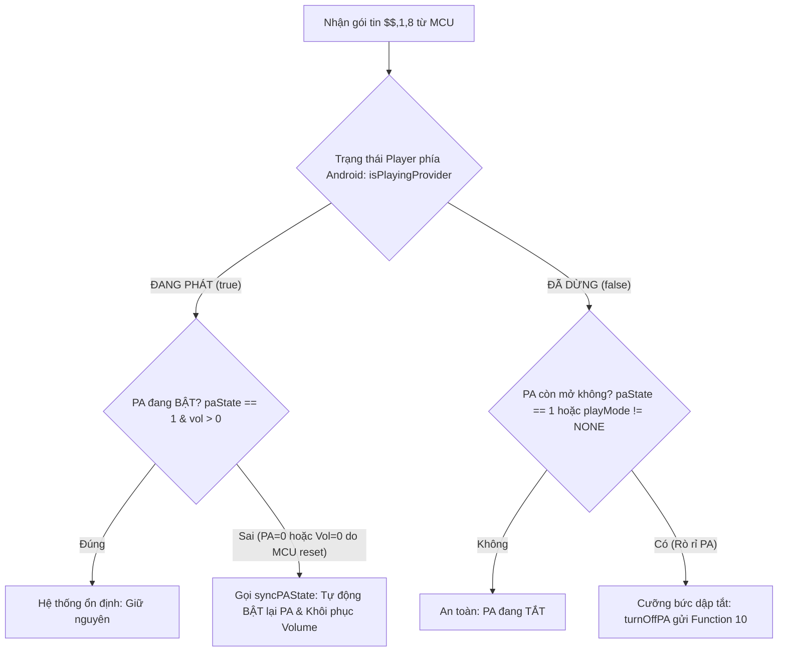

# Đặc Tả Giao Thức Truyền Thông UART Cụm Thu IPRadio (ICD)
> **Tài liệu tham chiếu gốc**: `<IPRADIO - FBR> YÊU CẦU GIAO THỨC TRUYỀN THÔNG CỤM THU AM/FM - Version 2.4`  
> **Đơn vị phát hành gốc**: Công ty TNHH RDS Việt Nam  
> **Đối tượng áp dụng**: Giao tiếp giữa ứng dụng Android (Player Box) và Bộ vi điều khiển (MCU) quản lý cụm thu FM & khuếch đại công suất PA.  
> **Mã nguồn liên kết**: [`SerialPortController.kt`](file:///d:/Git/IPRadio/app/src/main/java/app/tek4tv/ipradio/core/SerialPortController.kt), [`Define.java`](file:///d:/Git/IPRadio/app/src/main/java/app/tek4tv/ipradio/utils/Define.java)

---

## 1. Thông Số Vật Lý & Cấu Hình Kết Nối

* **Tốc độ truyền (Baudrate)**: `9600 bps`
* **Khung truyền (Frame format)**: `1-8-1-N`
  * Start bit: 1 bit
  * Data bits: 8 bits
  * Stop bit: 1 bit
  * Parity: None (Không kiểm tra chẵn lẻ)
* **Định dạng dữ liệu**: Toàn bộ các byte truyền và nhận đều được mã hóa dưới dạng ký tự **ASCII**.
* **Đường dẫn thiết bị trên Android**: Thường là `/dev/ttyS*` hoặc `/dev/ttyUSB*` được cấu hình qua thư viện JNI [`SerialPort.java`](file:///d:/Git/IPRadio/app/src/main/java/app/tek4tv/ipradio/core/SerialPort.java).

---

## 2. Cấu Trúc Khung Bản Tin (Frame Structure)

### 2.1. Chiều từ Android Box xuống Bộ điều khiển MCU
Cú pháp gửi:
```text
$$,<Function_ID>,<Data_1>,<Data_2>,...,<Data_n>,\r\n
```

| Trường dữ liệu | Số byte | Mã Hex (ASCII) | Diễn giải |
| :--- | :---: | :---: | :--- |
| **Start Pack** | 2 | `0x24, 0x24` | Ký tự bắt đầu bản tin: `$$` |
| **SP (Separator)**| 1 | `0x2C` | Dấu phẩy ngăn cách `,` |
| **Function ID** | $n$ | ASCII | Mã hàm chức năng (không cần chèn số `0` phía trước với ID < 10) |
| **SP (Separator)**| 1 | `0x2C` | Dấu phẩy ngăn cách `,` |
| **Data 1 .. n** | $m$ | ASCII | Các tham số dữ liệu của hàm, ngăn cách nhau bằng dấu phẩy `,` |
| **SP (Separator)**| 1 | `0x2C` | Dấu phẩy trước ký tự kết thúc |
| **End Pack** | 2 | `0x0D, 0x0A` | Ký tự kết thúc bản tin: `\r\n` (CR LF) |

### 2.2. Chiều từ Bộ điều khiển MCU phản hồi lên Android Box
Cú pháp nhận:
```text
$$,<Status_Byte>,<Data_1>,...,<Data_n>,\r\n
```

| Trường dữ liệu | Số byte | Giá trị | Diễn giải |
| :--- | :---: | :---: | :--- |
| **Start Pack** | 2 | `$$` | Bắt đầu bản tin phản hồi |
| **SP** | 1 | `,` | Dấu ngăn cách |
| **Status Byte** | 1 | `0` \| `1` \| `2` | **0**: Lệnh gần nhất bị lỗi tham số truyền.<br/>**1**: Lệnh gần nhất thực hiện thành công.<br/>**2**: Lệnh gần nhất chưa được thực hiện do MCU chưa sẵn sàng. |
| **Data 1 .. n** | $m$ | ASCII | Dữ liệu trả về (chỉ xuất hiện đối với các lệnh đọc trạng thái như Function 8, Function 9). |
| **End Pack** | 2 | `\r\n` | Kết thúc bản tin |

---

## 3. Danh Sách Chi Tiết Các Function ID

Bảng đối chiếu giữa tài liệu chuẩn giao thức v2.4 và hằng số định nghĩa trong [`Define.java`](file:///d:/Git/IPRadio/app/src/main/java/app/tek4tv/ipradio/utils/Define.java):

| Function ID | Hằng số mã nguồn | Tên chức năng | Số lượng tham số | Diễn giải chức năng |
| :---: | :--- | :--- | :---: | :--- |
| **`0`** | `FUNC_WRITE_PLAY_VOD_LIVE` | Play VOD, Line (Schedule) | 1 | Phát âm thanh theo lịch (VOD/Live stream). Bật nguồn PA và chuyển mạch Audio sang Android DAC. |
| **`1`** | `FUNC_WRITE_PLAY_TUNER` | Play Tuner | 3 | Tiếp sóng đài FM/AM theo lịch. Chuyển mạch Audio sang chip Tuner ngoại vi và bật PA. |
| **`2`** | `FUNC_WRITE_WATCH_DOG` | Watchdog & Network Status | 4 (Thực tế) | Gửi Watchdog định kỳ 3s để reset counter MCU và báo tình trạng sóng/mạng di động. |
| **`3`** | `FUNC_WRITE_FORCE_SET_PA` | Force switch PA ON/OFF | 1 | *(Đã bỏ trong Version 2.4 - Không sử dụng)*. |
| **`4`** | `FUNC_WRITE_FORCE_SET_MUTE` | Force MUTE or UNMUTE | 1 | Ngắt hoặc mở tiếng khẩn cấp toàn bộ hệ thống âm thanh (áp dụng mọi nguồn). |
| **`5`** | `FUNC_WRITE_FORCE_SET_VOLUME`| Force set volume | 1 | Cài đặt mức âm lượng khẩn cấp từ CMS/Hub. |
| **`6`** | `FUNC_WRITE_PLAY_VOD_LIVE_FORCE` | Play VOD (Live Force) | 2 | Phát bản tin khẩn cấp từ nguồn Android Box (đè kịch bản thường). |
| **`7`** | `FUNC_WRITE_PLAY_TUNER_FORCE` | Play Tuner (Live Force) | 4 | Phát tiếp sóng FM/AM khẩn cấp (đè kịch bản thường). |
| **`8`** | `FUNC_WRITE_READ_STATUS_PARAM` | Read status parameter | 0 | Yêu cầu MCU phản hồi 11 thông số vận hành (PA, Mute, Volume, Nguồn, Nhiệt độ...). |
| **`9`** | `FUNC_WRITE_READ_DEVICE_INFO` | Read device information | 0 | Đọc phiên bản Firmware và phần cứng của bo MCU. |
| **`10`** | `FUNC_WRITE_PLAY_NO_SOURCE` | Play nothing (Standby) | 0 | Tắt công suất PA, chuyển Audio về Mute để tiết kiệm điện và chống nổ loa khi hết ca phát. |
| **`11`** | `FUNC_WRITE_FORCE_RESTART_DEVICE` | Force restart device | 0 | Lệnh cưỡng bức khởi động lại bo mạch MCU. |
| **`13`** | `FUNC_WRITE_SETUP_PI_PS_NAME` | Setup PI and PS name | 2 | Cấu hình mã định danh cụm thu (PI) và tên đài (PS) cho hệ thống RDS. *(Đổi từ 12 thành 13 từ bản v2.4)*. |

---

## 4. Chi Tiết Tham Số & Quy Chuẩn Từng Bản Tin

### 4.1. Lệnh Phát Theo Lịch (Function 0 & 1)
* **Function 0: Phát VOD / Live qua Android Box**
  * Cú pháp gửi: `$$,0,<Volume>,\r\n`
  * `Volume`: Dải từ `0` đến `80`. (`0` tương ứng Mute, `80` tương ứng 100% công suất amply).
  * Hàm triển khai: [`turnOnPAVod()`](file:///d:/Git/IPRadio/app/src/main/java/app/tek4tv/ipradio/core/SerialPortController.kt#L219).
* **Function 1: Phát Tuner FM/AM theo lịch**
  * Cú pháp gửi: `$$,1,<FM_AM>,<Frequency>,<Volume>,\r\n`
  * `FM_AM`: `1` = FM, `0` = AM.
  * `Frequency`:
    * FM: Đơn vị $0.1\text{ MHz}$. Ví dụ: Đài $103.0\text{ MHz} \rightarrow$ gửi `1030`. Đài $91.0\text{ MHz} \rightarrow$ gửi `910`.
    * AM: Đơn vị $1\text{ KHz}$. Ví dụ: $645\text{ KHz} \rightarrow$ gửi `645`.
  * `Volume`: Dải từ `0` đến `80`.
  * Hàm triển khai: [`playTuner()`](file:///d:/Git/IPRadio/app/src/main/java/app/tek4tv/ipradio/core/SerialPortController.kt#L271).

---

### 4.2. Lệnh Watchdog & Giám Sát Kết Nối (Function 2)
Được Android gửi định kỳ mỗi **3 giây** thông qua coroutine [`onWatchDog()`](file:///d:/Git/IPRadio/app/src/main/java/app/tek4tv/ipradio/core/SerialPortController.kt#L72).

* **Bản tin Android gửi xuống**:
  ```text
  $$,2,<Status>,<MAC>,<NetworkType>,<SignalStrength>,\r\n
  ```
  *Ví dụ*: `$$,2,1,C4:4F:33:1A:88:2E,4G,-65dbm,\r\n`
  * `<Status>` (Trạng thái mạng):
    * `0`: Không có kết nối mạng Internet.
    * `1`: Có mạng và kết nối SignalR Hub bình thường.
    * `2`: Có mạng IP nhưng mất kết nối đến Hub máy chủ (`looseHubConnection`).
  * `<MAC>`: Địa chỉ MAC card mạng của thiết bị (dạng `XX:XX:XX:XX:XX:XX`).
  * `<NetworkType>`: Loại mạng (`2G`, `3G`, `4G`, `WIFI`), tối đa 4 ký tự.
  * `<SignalStrength>`: Độ nhạy sóng thu được (ví dụ: `-65dbm`), tối đa 8 ký tự.

* **Bản tin MCU phản hồi lên**:
  ```text
  $$,1,2,<PowerOnStatus>,\r\n
  ```
  * `<PowerOnStatus>`:
    * `1`: Thiết bị vừa bị mất điện và mới có điện trở lại (`Power-On`). App Android sẽ dựa vào cờ này để kích hoạt cơ chế tính điểm tua tiếp (Resume) kịch bản phát.
    * `0`: Thiết bị đang hoạt động bình thường liên tục.

---

### 4.3. Lệnh Phát Khẩn Cấp (Function 6 & 7)
* **Function 6: Live Force qua Android**
  * Cú pháp gửi: `$$,6,<Volume>,<Mute>,\r\n`
  * `Volume`: Dải `0 - 80`.
  * `Mute`: `0` = Unmute (mở tiếng), `1` = Mute.
* **Function 7: Live Force qua Tuner FM/AM**
  * Cú pháp gửi: `$$,7,<FM_AM>,<Frequency>,<Volume>,<Mute>,\r\n`
  * Hàm triển khai: [`playTunerLiveForce()`](file:///d:/Git/IPRadio/app/src/main/java/app/tek4tv/ipradio/core/SerialPortController.kt#L264).

---

### 4.4. Lệnh Đọc Trạng Thái Hoạt Động (Function 8)
* **Bản tin gửi**: `$$,8,,\r\n` (hàm [`updateStatus()`](file:///d:/Git/IPRadio/app/src/main/java/app/tek4tv/ipradio/core/SerialPortController.kt#L230)).
* **Bản tin MCU phản hồi**:
  ```text
  $$,1,8,P1,P2,P3,P4,P5,P6,P7,P8,P9,P10,P11,\r\n
  ```
  *Ví dụ thực tế*: `$$,1,8,1,910,675,5,2,1,0,0,32,01,VOV1,\r\n`

| Vị trí | Tham số | Ý nghĩa & Dải giá trị | Diễn giải |
| :---: | :--- | :--- | :--- |
| **P1** | FM / AM mode | `1`: FM, `0`: AM | Chế độ đài đang cấu hình |
| **P2** | FM Frequency | `540 – 680` và `880 – 1080` | Tần số FM (đơn vị 0.1 MHz, vd: 910 = 91.0 MHz) |
| **P3** | AM Frequency | `522 – 1710` | Tần số AM (đơn vị 1 KHz) |
| **P4** | Current Volume | `0 – 8` (hoặc dải `0 - 80`) | Mức âm lượng hiện thời của amply |
| **P5** | Audio Source | `0`: No source, `1`: FM/AM, `2`: IP (Android), `3`: External Mic | Nguồn âm thanh đang được cấp ra loa |
| **P6** | **Trạng thái PA** | **`1`: ON (BẬT), `0`: OFF (TẮT)** | **Trạng thái đóng rơ-le công suất PA** *(Trọng yếu để giám sát an toàn)* |
| **P7** | Trạng thái Mute | `1`: MUTE, `0`: UNMUTE | Trạng thái tắt tiếng tạm thời |
| **P8** | External MIC | `1`: MIC ON, `0`: MIC OFF | Trạng thái micro cắm ngoài trên bo mạch |
| **P9** | Temperature | `0 – 85` (đơn vị $^\circ\text{C}$) | Nhiệt độ đo được trên tản nhiệt công suất |
| **P10** | Mã cụm thu PI | `0 – 99` | Mã vùng phân cấp cụm thu |
| **P11** | PS name | Chuỗi ký tự ASCII (tối đa 8 ký tự) | Tên kênh chương trình đài phát (RDS) |

---

### 4.5. Lệnh Đọc Thông Tin Thiết Bị (Function 9)
* **Bản tin gửi**: `$$,9,,\r\n` (hàm [`readDeviceInfo()`](file:///d:/Git/IPRadio/app/src/main/java/app/tek4tv/ipradio/core/SerialPortController.kt#L255)).
* **Bản tin MCU phản hồi**:
  ```text
  $$,1,9,<Software_Version>,<Hardware_Version>,\r\n
  ```
  *Ví dụ*: `$$,1,9,RTM 2.0.0,1.3,\r\n`

---

### 4.6. Lệnh Tắt Công Suất PA & Chế Độ Nghỉ (Function 10 - Play Nothing)
* **Bản tin gửi**:
  ```text
  $$,10,,\r\n
  ```
* **Chức năng**:
  * Khi hết khung giờ phát, nhận lệnh `STOP` từ Hub hoặc khi dừng phát thanh: Android gửi Function 10 để ra lệnh cho MCU ngắt rơ-le cấp nguồn cho amply công suất (PA = OFF), đưa nguồn vào về trạng thái Mute.
  * Giúp triệt tiêu hoàn toàn tiếng sôi/xì rác ra loa, bảo vệ màng loa nén không bị ngâm điện áp một chiều và giảm thiểu tiêu thụ điện năng khi ở chế độ chờ.
  * Hàm triển khai: [`turnOffPA()`](file:///d:/Git/IPRadio/app/src/main/java/app/tek4tv/ipradio/core/SerialPortController.kt#L213).

---

### 4.7. Lệnh Cấu Hình Mã Cụm Thu & Tên Đài RDS (Function 13)
* **Cú pháp gửi**:
  ```text
  $$,13,<PI_Code>,<PS_Name>,\r\n
  ```
  * `<PI_Code>`: Mã cụm thu, dải từ `0` đến `99`. Nếu ngoài dải này MCU sẽ báo lỗi (`Status Byte = 0`).
  * `<PS_Name>`: Chuỗi ký tự ASCII tối đa **8 ký tự**.
  * Hàm triển khai: [`setUpPiPsName()`](file:///d:/Git/IPRadio/app/src/main/java/app/tek4tv/ipradio/core/SerialPortController.kt#L251).

---

## 5. Cơ Chế Giám Sát An Toàn 2 Chiều (Safety Watchdog)

Để chống cháy nổ loa ngoài thực địa, trong [`SerialPortController.kt` (dòng 143-164)](file:///d:/Git/IPRadio/app/src/main/java/app/tek4tv/ipradio/core/SerialPortController.kt#L143-L164), hệ thống áp dụng cơ chế bắt chéo trạng thái thông qua phản hồi bản tin `$$ , 1, 8`:



1. **Bảo vệ chống rò rỉ PA**: Khi phần mềm đã hết giờ phát (`isActuallyPlaying == false`), nếu gói tin MCU báo `P6 == "1"` (PA vẫn đang bật), app lập tức gửi ngay lệnh `Function 10` để dập tắt PA cưỡng bức.
2. **Tự động khôi phục âm thanh**: Khi phần mềm đang phát (`isActuallyPlaying == true`), nếu nguồn điện chập chờn khiến MCU bị reset đột ngột về trạng thái tắt (`P6 == "0"`), app sẽ tự động đồng bộ lại bằng cách gọi [`syncPAState()`](file:///d:/Git/IPRadio/app/src/main/java/app/tek4tv/ipradio/core/SerialPortController.kt#L280) để bật lại PA tức thì.

