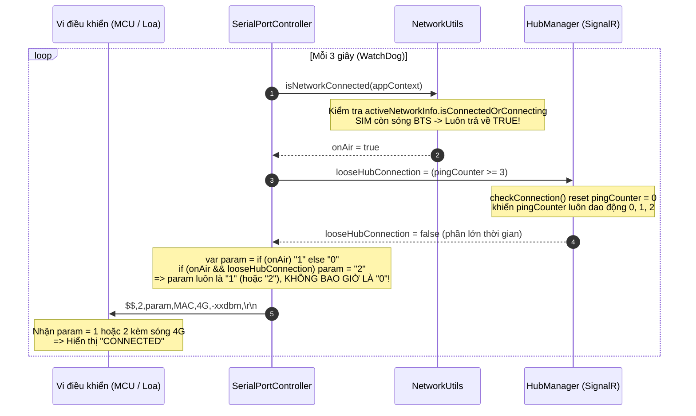

# Báo cáo phân tích logic báo trạng thái mạng qua Serial (Phiên bản 4.2.2b)

## 1. Tổng quan vấn đề
* **Hiện tượng**: Thiết bị sử dụng SIM 4G, khi SIM **hết data / hết gói cước Internet**, cổng Serial (UART) gửi xuống vi điều khiển (MCU bo mạch loa / màn hình) vẫn báo trạng thái **`connected`** (`param = 1` hoặc `2`), khiến đèn LED báo mạng hoặc màn hình hiển thị kết nối bình thường.
* **Mã nguồn liên quan**:
  - [`SerialPortController.kt`](file:///d:/Git/IPRadio/app/src/main/java/app/tek4tv/ipradio/core/SerialPortController.kt)
  - [`HubManager.kt`](file:///d:/Git/IPRadio/app/src/main/java/app/tek4tv/ipradio/core/HubManager.kt)
  - [`NetworkUtils.kt`](file:///d:/Git/IPRadio/app/src/main/java/app/tek4tv/ipradio/utils/network/NetworkUtils.kt)

---

## 2. Sơ đồ luồng hoạt động hiện tại (Phiên bản 4.2.2b)



---

## 3. Phân tích chi tiết 3 nguyên nhân cốt lõi

### Nguyên nhân 1: `NetworkUtils.isNetworkConnected()` chỉ kiểm tra sóng di động, không kiểm tra Internet thực tế
* **Vị trí**: [`NetworkUtils.kt` (dòng 125-132)](file:///d:/Git/IPRadio/app/src/main/java/app/tek4tv/ipradio/utils/network/NetworkUtils.kt#L125-L132)
```kotlin
fun isNetworkConnected(context: Context): Boolean {
    val cm = context.getSystemService(Context.CONNECTIVITY_SERVICE) as ConnectivityManager
    if (cm != null) {
        val activeNetwork = cm.activeNetworkInfo
        return activeNetwork != null && activeNetwork.isConnectedOrConnecting
    }
    return false
}
```
* **Phân tích kỹ thuật**:
  - Khi cắm SIM vào thiết bị, modem di động thiết lập kết nối Cellular (Radio Link + APN PDP Context) với trạm phát sóng BTS của nhà mạng (Viettel, VinaPhone, MobiFone...).
  - Thiết bị được cấp IP mạng nội bộ (CGNAT) để có thể vào các trang hỗ trợ / captive portal của nhà mạng.
  - Khi SIM **hết data / hết tiền cước**: Nhà mạng **không ngắt sóng di động**, mà chỉ chặn định tuyến (routing) gói tin ra ngoài cổng Internet công cộng (Internet Gateway).
  - Đối với Android OS, `activeNetwork.isConnectedOrConnecting` chỉ kiểm tra xem interface mạng có kết nối tầng liên kết hay không, do đó **luôn trả về `true`**.
  - Dẫn đến biến `onAir` trong `SerialPortController` luôn bằng `true`.

---

### Nguyên nhân 2: `HubManager.kt` reset `pingCounter = 0` làm `param` liên tục nhảy về `"1"` (OK)
* **Vị trí**: [`HubManager.kt` (dòng 479-491)](file:///d:/Git/IPRadio/app/src/main/java/app/tek4tv/ipradio/core/HubManager.kt#L479-L491)
```kotlin
private suspend fun checkConnection() {
    if (pingCounter >= 3) {
        Log.e(LOG_TAG, "Losed hub connection")
        hubToken = null
        pingCounter = 0 // <-- LỖI: Reset pingCounter về 0 ngay cả khi kết nối lại thất bại!
        openConnection()
    }
}
```
* **Vị trí trong `SerialPortController.kt` (dòng 69, 82-84)**:
```kotlin
val looseHubConnection = hubManager.pingCounter >= 3
...
var param = if (onAir) "1" else "0"
if (onAir && looseHubConnection) {
    param = "2"
}
```
* **Hiện tượng lặp luẩn quẩn**:
  1. Khi SIM hết data, SignalR Hub không thể kết nối. Hàm `sendPing()` mỗi 30s tăng `pingCounter` lên 1: `1 -> 2 -> 3`.
  2. Khi `pingCounter == 3`, `checkConnection()` được gọi. Tại đây, code gán ngay **`pingCounter = 0`** rồi gọi `openConnection()`.
  3. `openConnection()` thất bại (do hết data), nhưng `pingCounter` lúc này đã bị gán về `0`.
  4. Luồng Watchdog trong `SerialPortController` chạy mỗi 3 giây:
     - Đọc `hubManager.pingCounter` = `0` (< 3) => `looseHubConnection` lại thành **`false`**.
     - Vì `onAir = true` và `looseHubConnection = false` => `param` lập tức nhảy lại thành **`"1"`**!
  5. Trong 90 giây tiếp theo (`pingCounter` lần lượt là `0, 1, 2`), chuỗi Serial liên tục bắn giá trị **`1`** (Báo có mạng và kết nối Hub tốt).

---

### Nguyên nhân 3: `param` không bao giờ bằng `"0"` kết hợp chuỗi `4G, -xx dbm`
* **Vị trí**: [`SerialPortController.kt` (dòng 99-102)](file:///d:/Git/IPRadio/app/src/main/java/app/tek4tv/ipradio/core/SerialPortController.kt#L99-L102)
```kotlin
param = "$param,$deviceMac,$networkClass,${strength}"
val mes: String = buildWriteMessage(Define.FUNC_WRITE_WATCH_DOG, param)
outputStream!!.write(mes.toByteArray())
```
* **Giao thức Serial**: Chuỗi gửi xuống MCU có dạng:
  `$$,2,<param>,<deviceMac>,<networkClass>,<strength>,\r\n`
  Ví dụ: `$$,2,1,80:7d:3a:XX:XX:XX,4G,-75dbm,\r\n`
* **Quy ước tham số `param`**:
  - `0`: Không có mạng (Not Internet).
  - `1`: Có mạng và đã kết nối Hub (OK).
  - `2`: Có mạng nhưng mất kết nối Hub (Internet, Hub Disconnected).
* Vì `onAir` luôn là `true`, `param` chỉ mang giá trị `"1"` hoặc `"2"`, **tuyệt đối không bao giờ trả về `"0"`**.
* Vi điều khiển ngoại vi (MCU) khi đọc chuỗi `$$,2,...`:
  - Nếu `param` là `1` hoặc `2` (hoặc kiểm tra `param != 0`), MCU đều hiểu là thiết bị đang có mạng.
  - Kèm theo thông số sóng 4G tốt (`-75dbm`), MCU hiển thị trạng thái **"CONNECTED"** trên màn hình / bật đèn LED mạng.

---

## 4. Ma trận so sánh trạng thái

| Tình trạng thực tế | `onAir` hiện tại | `looseHubConnection` hiện tại | `param` hiện tại gửi đi | Trạng thái MCU hiển thị | Trạng thái mong muốn |
| :--- | :---: | :---: | :---: | :---: | :---: |
| **Có mạng 4G, Hub kết nối OK** | `true` | `false` | **`1`** | Connected | **`1` (Connected)** |
| **Có mạng 4G, Hub bị mất kết nối** | `true` | `true` (ngắn ngủi) / `false` | **`2`** rồi lại về **`1`** | Connected | **`2` (Mất kết nối Hub)** |
| **SIM hết data / hết tiền** | `true` ❌ | `false` (90% thời gian) ❌ | **`1`** (hoặc `2`) ❌ | **Connected** ❌ | **`0` (Mất mạng hoàn toàn)** |
| **Rút SIM / Mất hẳn sóng 4G** | `false` | `true` | **`0`** | Disconnected | **`0` (Mất mạng)** |

---

## 5. Giải pháp khắc phục đề xuất (Code chi tiết)

### Bước 1: Bổ sung kiểm tra Internet thực tế trong `NetworkUtils.kt`
Kiểm tra khả năng thông gói tin thực tế bằng cách mở kết nối Socket nhanh (timeout 1.5s) tới DNS công cộng (`8.8.8.8:53` hoặc `1.1.1.1:53`). Đồng thời chạy ngầm cập nhật biến cờ định kỳ để không làm đơ luồng Watchdog.

```kotlin
// Trong NetworkUtils.kt:
class NetworkUtils private constructor() {
    ...
    @Volatile
    var isInternetAvailable: Boolean = false
        private set

    // Hàm kiểm tra socket trực tiếp ra Internet
    fun checkInternetAccess(): Boolean {
        return try {
            val socket = java.net.Socket()
            val socketAddress = java.net.InetSocketAddress("8.8.8.8", 53)
            socket.connect(socketAddress, 1500)
            socket.close()
            true
        } catch (e: Exception) {
            false
        }
    }
    
    // Coroutine cập nhật định kỳ (mỗi 5-10 giây)
    fun startInternetCheckLoop(scope: CoroutineScope) {
        scope.launch(Dispatchers.IO) {
            while (isActive) {
                isInternetAvailable = if (isNetworkConnected(appContext)) {
                    checkInternetAccess()
                } else {
                    false
                }
                delay(5000)
            }
        }
    }
}
```

---

### Bước 2: Chuẩn hóa trạng thái kết nối trong `HubManager.kt`
1. Không tự động reset `pingCounter = 0` khi kết nối lại thất bại. Chỉ reset về `0` khi nhận bản tin `HubCommand.PONG` từ máy chủ.
2. Cung cấp hàm kiểm tra trạng thái SignalR chính xác:
```kotlin
// Trong HubManager.kt:
val isHubConnected: Boolean
    get() = hubConnection.connectionState == com.microsoft.signalr.HubConnectionState.CONNECTED && pingCounter < 3

private suspend fun checkConnection() {
    if (pingCounter >= 3) {
        Log.e(LOG_TAG, "Lost hub connection")
        hubToken = null
        // KHÔNG gán pingCounter = 0 ở đây!
        val connId = openConnection()
        if (connId != null) {
            pingCounter = 0 // Chỉ reset khi kết nối lại thành công
        }
    }
}
```

---

### Bước 3: Cập nhật logic `onWatchDog()` trong `SerialPortController.kt`
Phân cấp điều kiện chuẩn xác theo 3 trạng thái:
```kotlin
// Trong SerialPortController.kt (hàm onWatchDog):
private fun onWatchDog() {
    if (outputStream != null) {
        try {
            val hasInternet = NetworkUtils.instance.isInternetAvailable
            val isHubOk = hubManager.isHubConnected

            // 0: Không có Internet (hoặc SIM hết data)
            // 1: Có Internet và đã kết nối Hub thành công
            // 2: Có Internet nhưng mất kết nối đến Hub
            val param = when {
                !hasInternet -> "0"
                !isHubOk -> "2"
                else -> "1"
            }

            val networkClass = NetworkUtils.getNetworkClass(appContext)
            val strength = when (networkClass) {
                "2G", "3G", "4G" -> {
                    val cellStrength = NetworkUtils.getCellSignalStrengthInDbm(appContext)
                    if (cellStrength != CellSignalStrength.SIGNAL_STRENGTH_NONE_OR_UNKNOWN)
                        "${cellStrength}dbm"
                    else "undefine"
                }
                "WIFI" -> "${NetworkUtils.getWifiSignalStrength(appContext)}dbm"
                else -> "---"
            }

            val data = "$param,$deviceMac,$networkClass,$strength"
            val mes: String = buildWriteMessage(Define.FUNC_WRITE_WATCH_DOG, data)
            outputStream!!.write(mes.toByteArray())
        } catch (e: IOException) {
            e.printStackTrace()
        }
    }
}
```
